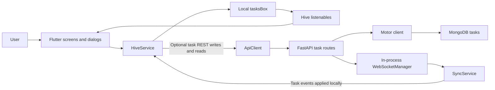

# Momentum technical architecture

Voice task extraction uses the pure-Dart chrono_dart package for bounded calendar
phrases alongside local Hindi/Hinglish command rules. No additional inference
model or service is needed. Extracted fields and interpretation notes enter the
existing review form; only explicit Save writes to Hive.

Voice recording feedback: the existing local PCM stream also supplies a normalized
sound level through `VoiceCapture.level`. A bounded UI-only history draws the live
waveform. No separate microphone, service or network connection is introduced.

Current direction (2026-10-28): fully offline voice-to-task creation and edit/completion commands on Android and Windows, with Hindi, English and mixed speech. No external inference API dependency. The earlier hosted-provider AI plan is superseded by this constraint. See [offline voice implementation and validation](OFFLINE_VOICE.md).

Implementation update (2026-10-28): immutable task/step IDs, Hive schema-v3 step migration, and exact positive-minute handling are now implemented. The AI tools and focus-session feature remain planned. See [verified foundation changes](details.md#j-implemented-foundations).

Assessment: 2026-10-28. Current means confirmed in the working tree, not verified
on every platform. Proposed means planned, not implemented. The user has specified
seven AI/focus tools; the local-first foundation below is extended by the AI section
at the end and [PRD.md](PRD.md)'s A1-A7/AX requirements.

## Current system and boundaries



The optional path runs only when MOMENTUM_CLOUD_SYNC_ENABLED is true. It is a
development sync starter, not a reliable offline queue. There is no server involved
in default local operation, and no direct client-to-MongoDB connection.

| Boundary | Current responsibility and evidence |
| --- | --- |
| App startup | lib/main.dart initializes Flutter, Hive, TaskAdapter, HiveService, then MyApp; MainScreen supplies navigation, theme and foreground motto timers. |
| UI | lib/screens contains period views, tasks, dashboard, journal, journey, instructions, goals, reward history, streaks, productivity and Log & Earn. lib/widgets contains common dialogs, bubbles, summaries and profile widgets. |
| Local application service | lib/services/hive_service.dart owns tasks, recurrence, metadata, journals, instruction history, rewards, derived snapshots and cloud hooks. This is a large service, not a layered repository framework. |
| Models/utilities | lib/models/task_model.dart uses a generated Hive adapter. Other domain models serialize lists/maps. lib/utils/task_time_utils.dart parses phase metadata; text_formatters.dart and grid_utils.dart are reuse points. |
| REST adapter | lib/services/api_client.dart serializes tasks and uses package:http. |
| Socket adapter | lib/services/sync_service.dart opens web_socket_channel, invokes event callback, exposes REST convenience methods. No reconnect/backoff loop is implemented. |
| Backend | backend/main.py contains all routes, owner resolution, schedule validation, persistence orchestration and broadcasting. backend/models.py defines Pydantic payloads/events. |
| Persistence/infrastructure | backend/database.py loads dotenv, creates a module-level Motor client and tasks collection; websocket_manager.py keeps user-scoped connection lists in process memory. |

Detailed inventory, configuration, endpoints and observations live in
[details.md](details.md), which is the evidence reference rather than another
proposed folder tree. Do not split the existing Flutter client by platform.

## Current data and execution model

Hive opens `Box<List>('tasksBox')`. Date strings index lists of Task records.
Reserved `__...` keys store settings and domain lists. Task's adapter is typeId 0,
legacy fields 0-15 unchanged, plus field 16 (immutable id), 17 (typed steps),
and 18 (frozen legacy cloud key). TaskStep uses typeId 1 and fields 0-8.
HiveService schema version 3 persists IDs and typed steps after the v1 metadata migration. Other domains use positional lists/maps,
so field order is part of compatibility even without generated adapters.

Task descriptions retain schedule markers and the original legacy phase text.
Typed steps are authoritative when present; the shared parser handles legacy records.
The editor saves structured steps and ordinary description text separately.
Daily Journal is synthesized from journal state rather than stored as an ordinary
task. Productivity snapshots and automatic journey entries derive from local data.
Reward goals and ledger entries live locally; no payment API exists.

A local task mutation reads a date list, writes it back, recalculates snapshots,
then may launch an unawaited cloud request. Hive listeners refresh the UI. On sync
startup, the service opens a socket and awaits a task pull (8-second timeout).
Cloud POST uses upsert and broadcasts; PUT emits its supplied fields, not the
complete persisted document. Incoming events are decoded into Task objects and
upserted locally, which is unsafe for partial payloads. See risk R2 in details.md.

MongoDB has one implemented domain collection, `tasks`, with a unique compound
index `(user_id, task_id)` created at startup. No SQL tables, ORM, Alembic migrations,
users collection, scheduler service, or server-side reward calculation is present.
Records have arbitrary allowed payload fields and server-assigned updated_at.
The current timestamp is a timezone-naive UTC string; it is not a conflict version.

## API, identity and integrations

REST exposes `/`, `/tasks`, and `/tasks/{task_id}`. WebSocket `/ws` accepts ping
and subscribe messages; ping gets pong, while subscription routing is established
from connection user_id, not a separate topic registration. Task persistence uses
REST. The endpoint contract is recorded in details.md.

REST owner filtering is implemented, but callers choose X-User-Id and can impersonate
another owner. WebSocket user_id is also caller supplied. Local profile data is
presentation, not a login. CORS defaults to `*` with credentials enabled; this is
not an authorization boundary. Public deployment is blocked until S2.

Other integrations are image_picker for local media, google_fonts for font loading,
and the optional MongoDB server. Fonts may need network/cache; local image paths
do not automatically transfer between platforms or devices. No Firebase, Supabase,
notification-provider, analytics SaaS, or external calendar implementation was found.
The hardcoded api.momentum.com URLs are defaults in source, not verified deployments
or evidence of domain ownership. Do not send user data there without configuration.

## Technology decisions and costs

| Decision | Selected approach / reason | Cost, learning and simpler option |
| --- | --- | --- |
| Client | Retain Flutter/Dart and existing views | Existing investment dominates; Dart is a learning requirement despite Python familiarity. A Python frontend rewrite has no demonstrated benefit. |
| State | Retain Hive listeners and local widget state | No new package or operational cost. Introduce only small seams for storage/clock tests; no blanket Provider/Riverpod/BLoC migration. |
| Local database | Retain Hive 2.x and append-compatible model migration | No hosting. Existing data makes SQLite conversion riskier than targeted fixes. Backup/recovery still requires explicit work. |
| HTTP/socket | Retain http and web_socket_channel | Installed, sufficient; centralize timeouts and lifecycle in the later sync milestone instead of adding Dio. |
| Backend | Retain FastAPI/Pydantic for S1/S2 | Fits Python familiarity and existing routes. No backend operation needed for P0. |
| Server data | Retain MongoDB; plan Motor-to-PyMongo Async migration before hosted rollout | One database avoids a costly SQL migration. Server/backup/patching cost depends on hosting choice; not estimated as free production hosting. |
| Tests | flutter_test; Python unittest plus HTTP testing support when S1 starts | Reuse installed tooling. Add httpx only if required for FastAPI TestClient; no Selenium for native Flutter. |
| Deployment | Native local pilot first; single backend process for later controlled sync | No Kubernetes, Kafka, Redis or multi-service platform. Single process is an explicit WS fan-out limit. |

Motor's upstream notice places it in critical-fix-only support after 2026-05-14,
with final support ending 2027-05-14. This justifies a focused driver migration if
the backend is developed, not replacement of the whole stack. [Upstream notice](https://github.com/mongodb/motor)
and [migration guide](https://www.mongodb.com/docs/languages/python/pymongo-driver/current/reference/migration/).

## Proposed local MVP architecture

Keep the same components. F1/F3 already have immutable task IDs; still add a small recoverable
date-move record inside existing Hive storage. A task ID identifies a stored
occurrence; recurring-series matching remains a separate existing rule. Migrate
without deleting user records and serialize local read-modify-write operations.
F2/F4 test and preserve view/domain behavior. F5 makes local failures visible and
keeps startup independent of optional task networking. No new external service,
database, runtime package, or generic repository abstraction is required.

See [design.md](design.md) for method-level behavior, file mapping, recovery and
tests. The six documents do not modify the application themselves.

## Error handling, monitoring and testing

Current backend uses HTTPException for invalid schedule/absent tasks, with otherwise
default framework errors. Socket failures are swallowed/disconnected; sends are
sequential. Client cloud failures use debugPrint. There is no durable retry queue,
structured observability pipeline, health dependency check, or managed alerting.
GET `/` is a process response, not continuous MongoDB readiness.

P0 needs actionable local-save errors and no private payload logging, plus storage
round-trip, migration, recurrence/reward, UI and offline smoke tests. Later backend
work should log operation, status, duration and request ID; avoid payloads and
credentials, use bounded retries only for transient errors, and expose readiness
without leaking topology. Tests must use isolated data. Detailed scenarios and
actual verification status are in design.md and details.md.

## Deployment and future architecture

Platform runners exist for Android, iOS, Windows, Linux, macOS and web. Their
presence is not verification of release support. Android release currently uses
debug signing; its main manifest does not declare INTERNET. macOS release sandbox
entitlements do not include outgoing network access. Several media widgets use
dart:io/File. Verify each target instead of declaring universal support.

P0 distributes a tested Windows build and Android pilot package, with explicit
data backup/restore and no hosted API. iOS requires a Mac/signing; web/media and
macOS networking are later platform work. No CI pipeline, container, Kubernetes,
cloud IaC, or deployment manifest was found in relevant source.

S1 adds durable pending mutations, stable remote identity, conflict versions,
deletion recovery and a serialized sync coordinator in the existing services.
S2 adds verified authentication for REST and sockets, account-isolated local state,
TLS, explicit CORS, credential management, backup/restore and deployment checks.
Use one Uvicorn worker initially because connection lists are process-local; add a
shared broadcast mechanism only when multiple workers become a measured need.
Do not add server collections for every existing local domain before its sync
requirements and privacy boundaries are defined.

## Proposed AI extension: separate assistance from task synchronization

Explicit user constraint: no Goblin Tools dependency, API calls, scraping, embedded
website or reused code/assets/branding. The features are independently implemented
in Momentum. The model provider below means a separately chosen AI provider or
locally hosted model, never Goblin Tools.

Reuse the Flutter app, Hive and FastAPI. Add one stateless request/response path:

```text
Task actions / shared AI Tools screen
  -> AiClient (Flutter HTTP)
  -> FastAPI /ai/assist (authentication, limits, schema validation)
  -> AiService (operation-specific instructions and output validation)
  -> one configured model provider
  -> editable preview
  -> explicit user Apply -> HiveService -> existing progress views
```

Focus sessions and next-step ordering run locally; neither needs a model call per
tick. The provider cannot mutate Hive, complete tasks, award rewards or send messages.
Use six distinct typed AI operations behind one endpoint: breakdown, estimate,
rewrite, tone, explain, decide. Focus composes ordinary app behavior with optional
breakdown/estimate actions. Each operation has its own small schema/instructions;
shared transport, limits and error mapping prevent duplication.

One provider/model is enough for the pilot. Select it using structured-output
support, latency, reviewed task quality, retention terms and measured cost. Pin the
chosen SDK/model after evaluation; do not build a provider marketplace or automatic
multi-provider fallback. A local model is a later deployment option if measured
privacy/offline requirements justify hardware and maintenance effort.

Critical repository integration: backend/main.py currently imports MongoDB and
creates an index during startup. AI-only service operation must not depend on a
working task-sync database. Introduce explicit TASK_SYNC_ENABLED configuration:
preserve the current true default for existing sync development, but launch AI-only
mode with false. In that mode, avoid database initialization entirely, skip its
startup hook and make task/WS routes fail closed as disabled. Test both modes.
MOMENTUM_AI_ENABLED is separate from MOMENTUM_CLOUD_SYNC_ENABLED on Flutter.
Manage conditional startup/shutdown together through FastAPI lifespan when making
this change; do not retain a competing startup handler that unconditionally touches
MongoDB. [FastAPI lifespan guidance](https://fastapi.tiangolo.com/advanced/events/).

The first desktop spike binds to loopback and uses synthetic inputs. Before mobile
or hosted exposure, authenticate AI requests, enforce per-user/concurrency/spend
limits, and use HTTPS. Do not expose unprotected existing task routes alongside a
protected AI endpoint. This limited AI access gate is required now; it does not
require implementing full bidirectional task sync or all S2 account migrations.
Provider key, model ID, timeout and quotas live in server configuration. Only
request IDs, operation, usage and timing enter operational logs, not prompt bodies.

Persist accepted structured steps and a local focus checkpoint; do not store all
AI prompts/responses in MongoDB by default. Existing legacy phase descriptions
remain readable during a tested migration. Detailed schemas and file ownership are
in design.md. No new database, Redis, broker, vector index or agent framework is
proposed for this extension.
